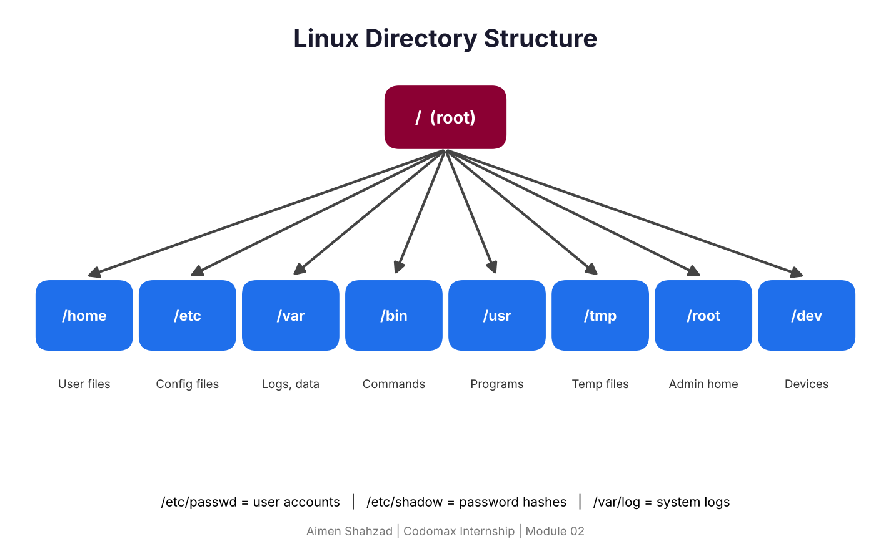
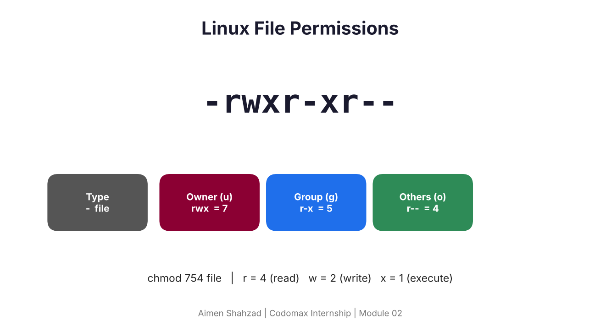

# 1. Linux Fundamentals

Linux is an open-source operating system used by most servers and by security distributions such as Kali Linux. Knowing Linux is essential for cybersecurity work.

## 1.1 Directory structure

| Directory | Purpose |
|---|---|
| `/` | Root of the whole file system |
| `/home` | Personal folders of normal users |
| `/root` | Home directory of the administrator (root) |
| `/etc` | System configuration files |
| `/var` | Variable data such as logs (`/var/log`) |
| `/bin`, `/usr` | Commands and installed programs |
| `/tmp` | Temporary files |
| `/dev` | Device files |

## 1.2 Basic file and directory commands

| Command | Purpose |
|---|---|
| `pwd` | Show current directory |
| `ls -la` | List files with details and hidden files |
| `cd /path` | Change directory |
| `mkdir name` | Create a directory |
| `touch file` | Create an empty file |
| `cp a b` / `mv a b` | Copy / move or rename |
| `rm file` / `rm -r dir` | Delete file / directory |
| `cat`, `less`, `head`, `tail` | View file contents |
| `grep "word" file` | Search text inside files |
| `find / -name file` | Search for files |
| `man command` | Show manual of a command |

## 1.3 Permissions

- Each file has permissions for the **owner (u)**, **group (g)** and **others (o)**.
- `r` = read (4), `w` = write (2), `x` = execute (1).
- Example: `chmod 754 script.sh` gives owner `rwx`, group `r-x`, others `r--`.
- `chown user:group file` changes ownership.
- Security idea: give the **minimum permissions** needed (least privilege). Avoid `chmod 777`.

## 1.4 Users and groups

| Command / File | Purpose |
|---|---|
| `whoami`, `id` | Show current user and group IDs |
| `sudo command` | Run a command with administrator rights |
| `useradd`, `passwd`, `userdel` | Create user, set password, delete user |
| `groups`, `usermod -aG group user` | Show groups, add user to a group |
| `/etc/passwd` | List of user accounts |
| `/etc/shadow` | Password hashes (readable only by root) |

## 1.5 Processes

| Command | Purpose |
|---|---|
| `ps aux` | List all running processes |
| `top` / `htop` | Live process monitor |
| `kill PID` / `kill -9 PID` | Stop a process |
| `systemctl status|start|stop service` | Manage services |
| `ss -tuln` / `netstat -tuln` | Show listening ports |

## 1.6 Linux security basics

- Keep the system updated: `sudo apt update && sudo apt upgrade`.
- Use strong passwords and SSH keys; disable root login over SSH.
- Use a firewall (`ufw enable`, `ufw allow 22`).
- Remove unused services and software to reduce the attack surface.
- Review logs: `/var/log/auth.log`, `/var/log/syslog`.
- Use `sudo` instead of working as root all the time.
