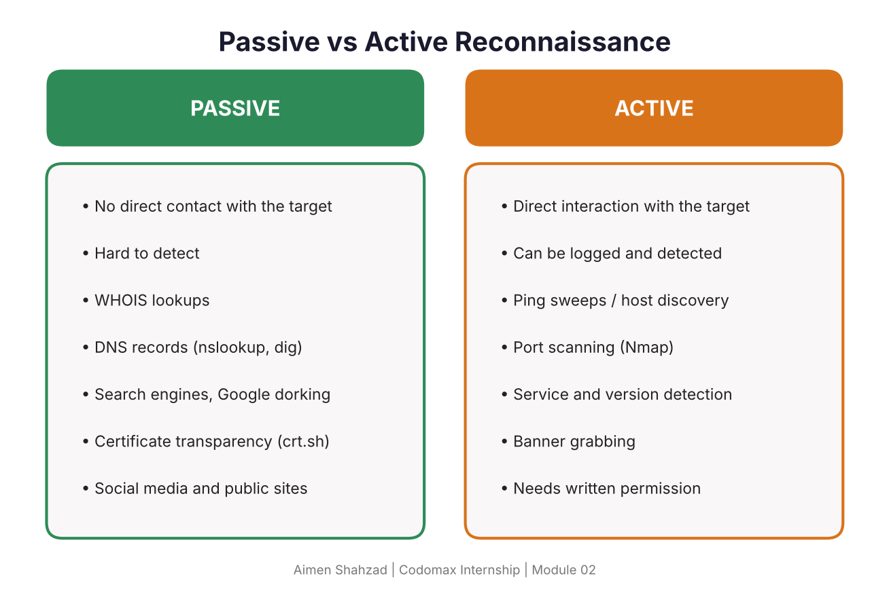
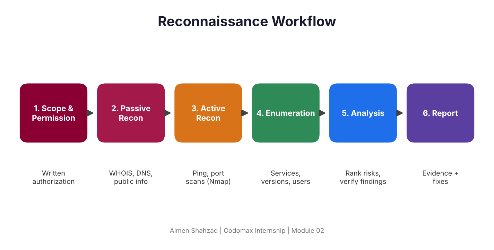

# 2. Reconnaissance

Reconnaissance (recon) is the first phase of a security assessment: collecting information about a target to understand its attack surface.



## 2.1 Passive vs active reconnaissance

| Feature | Passive | Active |
|---|---|---|
| Contact with target | None | Direct |
| Detection risk | Very low | Can be logged / detected |
| Examples | WHOIS, DNS lookup, search engines, public records | Ping sweep, port scan, banner grabbing |
| Permission needed | Public data only | **Written permission required** |

## 2.2 DNS and domain information gathering

| Record | Meaning |
|---|---|
| A / AAAA | Domain to IPv4 / IPv6 address |
| MX | Mail servers of the domain |
| NS | Name servers of the domain |
| TXT | Text data (SPF, domain verification) |
| CNAME | Alias pointing to another name |
| SOA | Zone administration information |

Useful tools: `whois`, `nslookup`, `dig`, `host`, online WHOIS, certificate transparency search (crt.sh), search-engine queries (Google dorking).

```
nslookup -type=MX example.com
nslookup -type=NS example.com
dig example.com ANY
whois example.com
```

## 2.3 Network enumeration

Enumeration means actively listing what a target exposes:

1. **Host discovery:** which devices are alive (`nmap -sn`).
2. **Port scanning:** which ports are open (`nmap -p-`).
3. **Service and version detection:** what runs on each port (`nmap -sV`).
4. **OS detection:** which operating system (`nmap -O`).
5. **Script scanning:** extra checks (`nmap -sC`).

## 2.4 Workflow


