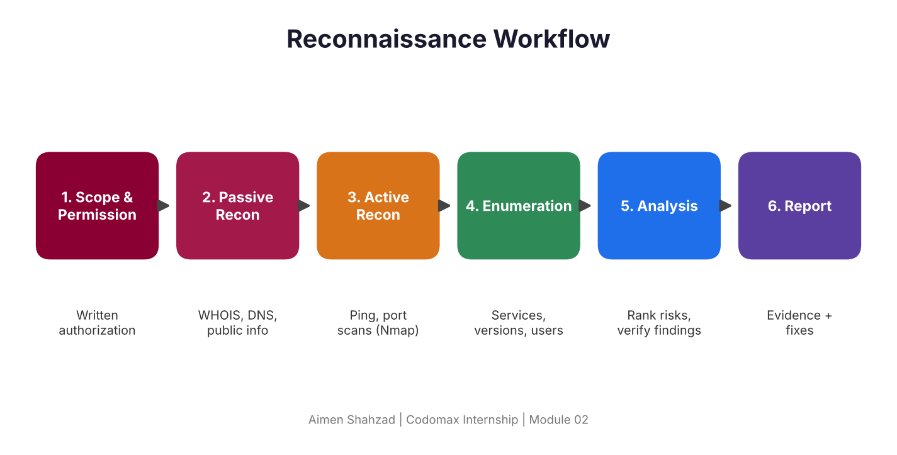

# Module 02: Linux, Security Tools & Reconnaissance

**Intern:** Aimen Shahzad
**Program:** BS Information Technology, Emerson University Multan
**Internship:** Codomax Digital Solutions (Online Cybersecurity Internship)
**Module:** 02 | 18/11/2026 - 22/11/2026

This repository contains my learning notes, cheat sheets, lab guide and report for Module 02. It covers Linux fundamentals, passive and active reconnaissance, essential security tools (Nmap, Wireshark, Burp Suite, OWASP ZAP) and a controlled reconnaissance lab.

> **Ethics notice:** Everything here is for education. Scanning and testing are done only on systems I own or that are explicitly provided for practice (for example `scanme.nmap.org`, OWASP Juice Shop, DVWA, `testphp.vulnweb.com`). Never test a system without written permission.

## Repository files

| File | Contents |
|---|---|
| `01-linux-fundamentals.md` | Files, directories, permissions, users, groups, processes, Linux security basics |
| `02-reconnaissance.md` | Passive vs active recon, DNS and domain information, network enumeration |
| `03-security-tools.md` | Nmap, Wireshark, Burp Suite and OWASP ZAP |
| `04-controlled-recon-lab.md` | Design, rules and workflow of the reconnaissance lab |
| `lab-guide.md` | Step-by-step lab tasks with commands |
| `lab-record.md` | Lab findings and observations |
| `cheatsheet-linux-commands.md`, `cheatsheet-nmap.md` | Quick reference cheat sheets |
| `Aimen_Shahzad_Module02_Report.pdf` | Full Module 02 report |
| `*.png` | Diagrams used in the notes |

## Key learning outcomes

- Navigate Linux, manage files, permissions, users and processes.
- Explain the difference between passive and active reconnaissance.
- Gather DNS and domain information and enumerate network services.
- Use Nmap, Wireshark, Burp Suite and OWASP ZAP for security analysis.
- Document findings in a clear, professional way.

## Author
Aimen Shahzad, Codomax Digital Solutions Cybersecurity Intern
